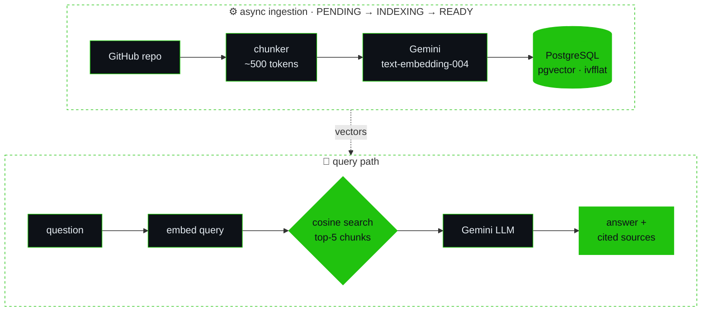
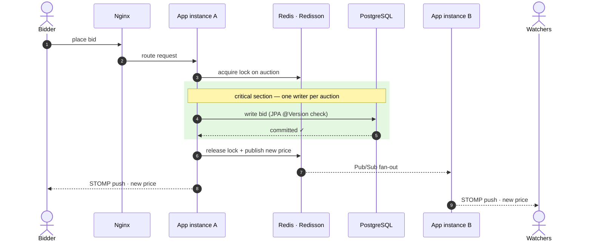
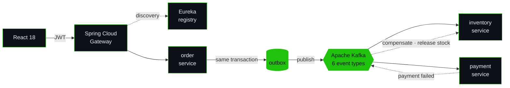

<!--
  ravi-kumar.service — GitHub profile README
  theme : production backend · terminal green #20C20E on #0d1117
  note  : the mermaid diagrams render natively on GitHub (no images needed)
-->

<p align="center">
  
</p>

<p align="center">
  
</p>

<p align="center">
  <a href="#about"><kbd>&nbsp;~/about&nbsp;</kbd></a>&nbsp;
  <a href="#stack"><kbd>&nbsp;~/stack&nbsp;</kbd></a>&nbsp;
  <a href="#services"><kbd>&nbsp;~/services&nbsp;</kbd></a>&nbsp;
  <a href="#decisions"><kbd>&nbsp;~/decisions&nbsp;</kbd></a>&nbsp;
  <a href="#metrics"><kbd>&nbsp;~/metrics&nbsp;</kbd></a>&nbsp;
  <a href="#connect"><kbd>&nbsp;~/connect&nbsp;</kbd></a>
</p>

```diff
@@  ravi-kumar.service · boot sequence  @@
+ [  OK  ]  Loaded      jvm.runtime ................ Java 17 · Java 21
+ [  OK  ]  Started     spring-boot.service ........ Security · Data JPA · Cloud Gateway
+ [  OK  ]  Mounted     postgres.volume ............ + pgvector · ivfflat index
+ [  OK  ]  Connected   kafka.cluster .............. event-driven saga · outbox
+ [  OK  ]  Acquired    redisson.lock .............. 0 conflicts @ 200 threads
+ [  OK  ]  Indexed     repolens.vectors ........... top-5 cosine · cited sources
+ [  OK  ]  Listening   :8080/api · /ws ............ REST + WebSocket (STOMP)
+ [  OK  ]  Passed      ci.pipeline ................ JUnit · Postgres + Redis containers
- [ WARN ]  Detected    coffee.level < 20% ......... auto-refill scheduled
@@  active (running) since 2023 · ready to accept requests  @@
```

## ~/about

```http
GET /api/v1/engineers/ravi-kumar HTTP/1.1
Host: github.com
Accept: application/json
```

<sub>⤷ <code>200 OK</code> · <code>Content-Type: application/json</code> · <code>X-Powered-By: Spring Boot</code></sub>

```json
{
  "name": "Ravi Kumar",
  "role": "Backend Software Engineer",
  "location": "Bengaluru, India",
  "education": {
    "degree": "B.E. Information Science & Engineering",
    "institute": "JSS Academy of Technical Education (VTU)",
    "batch": "2023 – 2027",
    "cgpa": 8.1
  },
  "primaryStack": ["Java", "Spring Boot", "PostgreSQL", "Kafka", "Redis"],
  "focus": [
    "distributed systems & event-driven architecture",
    "API security & real-time communication",
    "AI-integrated applications (RAG, vector search)",
    "clean architecture & backend performance"
  ],
  "motto": "I build backend systems that survive real-world usage."
}
```

## ~/stack

| layer | tools | in practice |
|:--|:--:|:--|
| **core** |  | Core & Advanced Java · Spring Boot · Spring Security · Spring Data JPA · Hibernate · Spring Cloud Gateway |
| **apis** |  | RESTful APIs · JWT · RBAC · WebSocket (STOMP) · Swagger / OpenAPI |
| **data** |  | PostgreSQL + pgvector · MySQL · MongoDB · Redis · Flyway · JDBC |
| **messaging** |  | Apache Kafka · event-driven architecture · transactional outbox · Redis Pub/Sub |
| **ai** |  | RAG · vector embeddings · semantic search · LLM API integration |
| **design** | 🏗️ | distributed systems · scalability · concurrency & multithreading · performance optimization · OOD |
| **infra** |  | Docker & Docker Compose · AWS · GitHub Actions CI/CD · Nginx |
| **quality** |  | JUnit (unit + integration) · concurrency testing · Git |
| **frontend** <sub>supporting</sub> |  | React 18 · Tailwind CSS · clean, API-driven UIs |

## ~/services

```console
$ docker compose ps
NAME       STATUS         STACK                                HIGHLIGHT
repolens   Up (healthy)   Spring Boot 3 · pgvector · Gemini    top-5 retrieval · cited answers
bidly      Up (healthy)   STOMP · Redisson · Redis Pub/Sub     0 conflicts @ 200 threads
shopmesh   Up (healthy)   Kafka saga · Gateway · Eureka        5 services · 6 event types
```

### `01` RepoLens &nbsp;<sub>AI-powered Q&A over any GitHub repository</sub>

> Ask a codebase anything in plain English. Every answer is grounded in retrieved code and cited back to its source.
>
> <a href="https://github.com/ravimehta251/RepoLens"></a>

<p>
  
  
  
  
  
  
</p>

- **Embedding pipeline:** splits code into ~500-token chunks and embeds them with Gemini `text-embedding-004`
- **Vector retrieval:** cosine-similarity search on PostgreSQL + pgvector (ivfflat index). The top-5 chunks ground every answer, with sources cited
- **Async ingestion:** an `@Async` pipeline tracks each repo through `PENDING → INDEXING → READY` across 4 REST endpoints
- **Shipped & tested:** the Postgres + pgvector stack is containerized with Docker Compose and validated by a JUnit suite (unit + integration)



### `02` Bidly &nbsp;<sub>real-time auction & bidding platform</sub>

> Live auctions where two people can never win the same item, even when they bid in the same millisecond.
>
> <a href="https://github.com/ravimehta251/bidly"></a>

<p>
  
  
  
  
  
  
  
  
</p>

- **Zero double-sells:** Redisson distributed locks plus JPA optimistic locking. A 200-thread concurrency test produced **0 conflicting writes**
- **Live price fan-out:** WebSocket (STOMP) broadcasts, with Redis Pub/Sub carrying updates across app instances behind an Nginx load balancer
- **12 secured REST endpoints** behind a React 18 UI with server-authoritative countdown timers
- **Gated CI:** GitHub Actions runs the JUnit suite against real PostgreSQL & Redis containers before building the Docker image



### `03` ShopMesh &nbsp;<sub>distributed, event-driven e-commerce microservices</sub>

> Checkout as a distributed saga. Every service owns its own data, with no distributed transactions.
>
> <a href="https://github.com/ravimehta251/ShopMesh"></a>

<p>
  
  
  
  
  
  
  
  
  
</p>

- **5 microservices** routed through Spring Cloud Gateway with Eureka service discovery, orchestrated via Docker Compose
- **Event-driven saga:** checkout runs over 6 Kafka event types using the transactional outbox pattern. Compensating events release stock when payment fails
- **Database-per-service:** 3 isolated MySQL schemas, each versioned with Flyway
- **Stateless JWT authorization** enforced across 6 gateway-routed endpoints



## ~/decisions

<sub>Architecture Decision Records: the <i>why</i> behind the code, and the cost I chose to pay.</sub>

| id | problem | decision | trade-off accepted |
|:-:|:--|:--|:--|
| `ADR-01` | Two bids hit the same auction in the same millisecond | Redisson distributed lock **+** JPA optimistic locking (`@Version`) as a second line of defense | an extra Redis round-trip per bid: cheap insurance against double-sells |
| `ADR-02` | Checkout spans services that each own their data | Saga over Kafka with a **transactional outbox**, plus compensating events on failure | eventual consistency and compensation logic, instead of a 2PC that doesn't scale |
| `ADR-03` | Live prices must reach clients connected to *any* instance | Redis Pub/Sub fan-out behind Nginx, pushed to browsers over STOMP | Pub/Sub is fire-and-forget, with no replay for a subscriber that was offline |
| `ADR-04` | Semantic search over code without adding a new datastore | pgvector inside PostgreSQL with an ivfflat index | approximate nearest-neighbour search, giving up a little recall for speed |
| `ADR-05` | Indexing a whole repository is slow | `@Async` ingestion with an explicit `PENDING → INDEXING → READY` lifecycle | callers check status instead of getting one blocking response |

## ~/metrics

```sh
$ curl -s localhost:8080/actuator/prometheus | grep ravi_

# HELP ravi_dsa_problems_solved_total  LeetCode problems solved
ravi_dsa_problems_solved_total{topics="arrays,strings,graphs,trees"}               500

# HELP ravi_hackathon_podiums_total  Podium finishes at hackathons
ravi_hackathon_podiums_total{event="HackAthena 2025",level="national",teams="1259"}  1
ravi_hackathon_podiums_total{event="JSSATE Hackathon",project="Snap2Clean"}          1

# HELP ravi_conflicting_writes_total  Double-sells under a 200-thread load test
ravi_conflicting_writes_total{service="bidly",threads="200"}                       0

# HELP ravi_cgpa  Current CGPA on a 10-point scale
ravi_cgpa{program="B.E. ISE"}                                                      8.1
```

| | result | context |
|:-:|:--|:--|
| 🥈 | **Runner-Up · HackAthena 2025** | National-level hackathon, 1,259 teams |
| 🥉 | **2nd Runner-Up · JSSATE Hackathon** | Built **Snap2Clean**, a civic-issue reporting platform (React · Google Maps API · MySQL), recognized for technical execution & social impact |
| ⚡ | **500+ DSA problems** | LeetCode: arrays, strings, graphs, trees |

<p align="center">
  
  
</p>

<p align="center">
  
</p>

## ~/connect

| method | channel | endpoint |
|:--|:--|:--|
| `POST` | 📧 mail | [ravi7481081raj@gmail.com](mailto:ravi7481081raj@gmail.com) |
| `GET` | 💼 linkedin | [linkedin.com/in/ravi-mehta2511](https://www.linkedin.com/in/ravi-mehta2511/) |
| `GET` | 💻 leetcode | [leetcode.com/u/ravi_kumar_129](https://leetcode.com/u/ravi_kumar_129) |
| `GET` | 🐙 github | [github.com/ravimehta251](https://github.com/ravimehta251) |

<p align="center">
  <br/>
  <i>"I build backend systems that survive real-world usage."</i>
  <br/><br/>
  
</p>

<p align="center">
  
</p>
